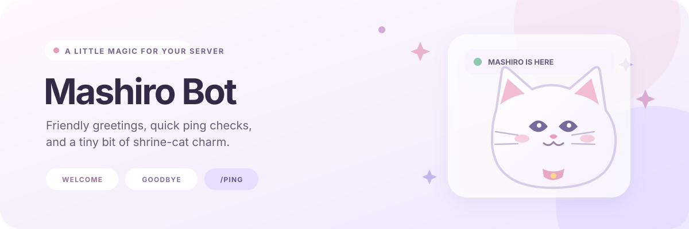

# Mashiro Bot

A small Discord bot for friendly server greetings and quick latency checks.

<p align="center">
  
</p>

## Features

- `/ping` replies with the bot's Discord gateway latency.
- Welcome and goodbye embeds post in the server's system channel.
- New members can receive a configured role when they join.
- An optional startup report can be sent to the bot owner by direct message.
- Embed images can be customized with HTTPS URLs.

## Requirements

- Node.js 24 LTS, or Docker with Compose.
- A Discord application installed with the `bot` and `applications.commands` scopes.
- The **Server Members Intent** enabled in the Discord Developer Portal for join and leave events.

## Install and run

```sh
cp .env.example .env
# Set BOT_TOKEN in .env
npm ci
npm start
```

To run with Docker Compose:

```sh
cp .env.example .env
# Set BOT_TOKEN in .env
docker compose up --build -d
```

View logs with `docker compose logs -f mashiro-bot`; stop the bot with `docker compose down`.

## Commands

| Command | Description |
| --- | --- |
| `/ping` | Replies with the current gateway latency. |

Register `/ping` with your Discord application before using it. This project loads command handlers but does not include a slash-command deployment script.

## Configuration

Copy `.env.example` to `.env` and edit the values you need.

| Variable | Purpose |
| --- | --- |
| `BOT_TOKEN` | Required Discord bot token. |
| `BOT_OWNER_ID` | Optional user ID that receives the startup report. |
| `WELCOME_ROLE_ID` | Optional role ID to assign to new members in the server that owns the role. |
| `WELCOME_THUMBNAIL_URL` / `WELCOME_BANNER_URL` | Optional welcome embed images. |
| `GOODBYE_THUMBNAIL_URL` / `GOODBYE_BANNER_URL` | Optional goodbye embed images. |
| `REPORTER_THUMBNAIL_URL` | Optional startup report image. |

Clear an image URL to omit that image. The bot needs **View Channel**, **Send Messages**, and **Embed Links** in the system channel. To assign the configured role, it also needs **Manage Roles**, and its highest role must be above that role. A role ID belongs to one server; use a separate bot configuration for another server.

## License

This project is licensed under the [ISC License](https://opensource.org/license/isc-license-txt/), as stated in `package.json`.
